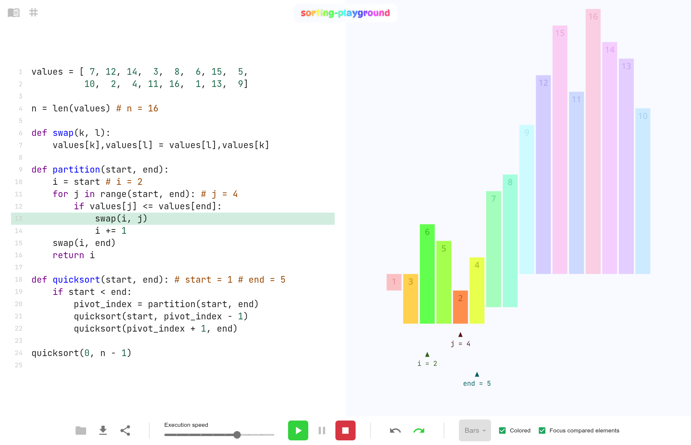
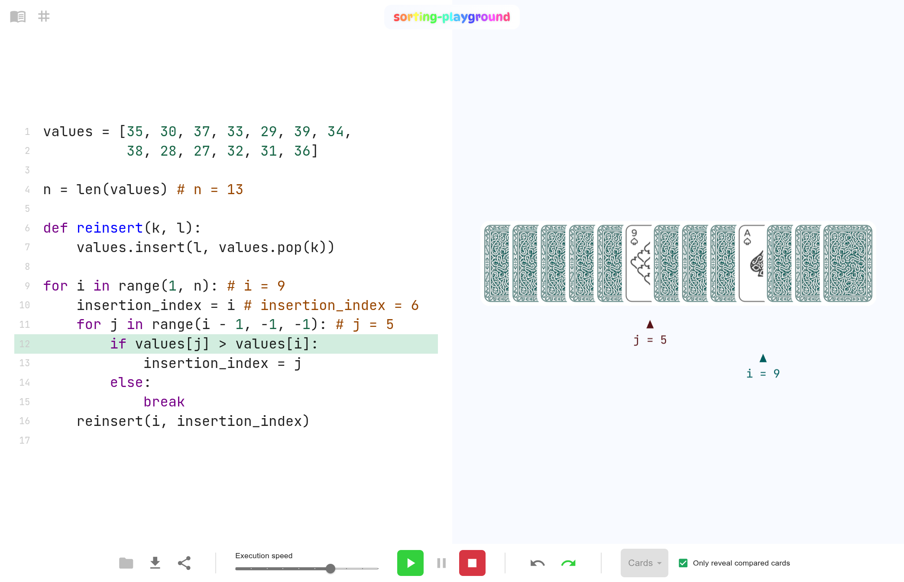
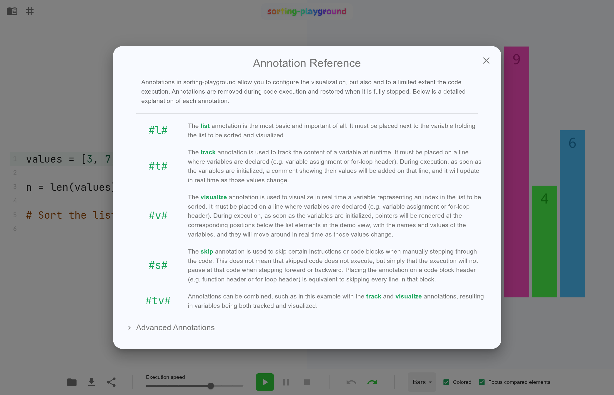

[](https://raja-s.github.io/sorting-playground/?l=en&s=H4sIAKRD02oAA22SUU_CMBSF_8pNeRmxJAxEdIEXeTYxmvgCi6nsooXRYtcNCOG_e7utY6JLmnanX0_vuemJZVZYZNGJiaWVBT4f7ZdWM52QxgqR5pjBFOYw5hAOaNxygCGNexp39D-iecQXCpov7JNEKBAahjQIAze7Yw8xdNLOQi2UItsUVVDd0YWOLeUEV5DtxS7YcEi7EXQykp1txc03Ma9XaUwOzdqrm9i77ISx0kqtAopoLAdUiTMsAlpEw27tK8mlBKiCIhh4eaUNrEEqMEJ94pUFgaEHS4-VL2Qdw6Spiug4arcGqmiSw7r7W5dwM4Ww0jzjLqsUgzY3CqSP9p3L5SbTxl7XlVRCz_37fNTPMt7EUa1ydrLQ9l2S4YFa8G-3yqRNp9z35-a2Sw_CVqwL2mZu3FOoki3UBaE3o-rzjDM84DJ3xbzuEBMWjTlLcKvfJO6fqpf5IUxGoJtmOtXGUdbkyNlKL3PSthQIk0eH1RtapccXLFCkfncmTFJvnzkr0GR0JYv65x_doc0hFgMAAA)

<i>Example execution of a Quicksort implementation with colored bars.</i> (<a href='https://raja-s.github.io/sorting-playground/?l=en&s=H4sIAKRD02oAA22SUU_CMBSF_8pNeRmxJAxEdIEXeTYxmvgCi6nsooXRYtcNCOG_e7utY6JLmnanX0_vuemJZVZYZNGJiaWVBT4f7ZdWM52QxgqR5pjBFOYw5hAOaNxygCGNexp39D-iecQXCpov7JNEKBAahjQIAze7Yw8xdNLOQi2UItsUVVDd0YWOLeUEV5DtxS7YcEi7EXQykp1txc03Ma9XaUwOzdqrm9i77ISx0kqtAopoLAdUiTMsAlpEw27tK8mlBKiCIhh4eaUNrEEqMEJ94pUFgaEHS4-VL2Qdw6Spiug4arcGqmiSw7r7W5dwM4Ww0jzjLqsUgzY3CqSP9p3L5SbTxl7XlVRCz_37fNTPMt7EUa1ydrLQ9l2S4YFa8G-3yqRNp9z35-a2Sw_CVqwL2mZu3FOoki3UBaE3o-rzjDM84DJ3xbzuEBMWjTlLcKvfJO6fqpf5IUxGoJtmOtXGUdbkyNlKL3PSthQIk0eH1RtapccXLFCkfncmTFJvnzkr0GR0JYv65x_doc0hFgMAAA'>Try it!</a>)

<!-- TOC -->
* [Introduction](#introduction)
* [Design Choices](#design-choices)
  * [Simple UI](#simple-ui)
  * [Sorting with a full programming language](#sorting-with-a-full-programming-language)
  * [Live Visualization (and playing cards ♣️♦️♠️♥️ as a bonus!)](#live-visualization-and-playing-cards-%EF%B8%8F%EF%B8%8F%EF%B8%8F%EF%B8%8F-as-a-bonus)
  * [Explicit Annotations](#explicit-annotations)
  * [Easy Sharing](#easy-sharing)
* [Tech Stack](#tech-stack)
* [Sorting Algorithm Implementations](#sorting-algorithm-implementations)
* [Development Note](#development-note)
<!-- TOC -->

## Introduction

`sorting-playground` is an educational sandbox environment designed for students learning sorting algorithms.
It is a webapp consisting of a basic Python editor with a fully local runtime environment tied to a live visualization, allowing users to follow along the execution, pause it, step forward/backward like in a debugger, and analyze the logic at their own pace.

Try it out here: available in [🇬🇧🇺🇸 English](https://raja-s.github.io/sorting-playground/?l=en) and [🇫🇷 French](https://raja-s.github.io/sorting-playground/?l=fr).

## Design Choices

Several core design choices drove the development of this application:

### Simple UI

Despite the application's inner complexity, the interface is fairly minimal and user-friendly: UI elements are large, self-explanatory iconography and colors are used to convey meaning (assisted with tooltips on hover), and borders are avoided where unnecessary.

This can be observed for example in the code editor, which has the bare minimum UI elements. When you open the playground for the first time, you are presented with three simple lines of code with an extra large font size and clean non-intrusive line numbers to the side for reference. The editor melts into the UI and gradually reduces the font size automatically as the code grows.

This simplicity of the UI is essential given the educational nature of the application. It must feel welcoming and intuitive to students (many of whom are uneasy with programming) and allow them to focus on the topic being studied: sorting algorithms.

> [!NOTE]
> The UI design choices here remain subjective and were not reviewed for proper accessibility by an expert.
> UI will be tweaked in case serious accessibility issues are discovered.
> Feel free to give feedback if you have such concerns regarding accessibility.

### Sorting with a full programming language

While algorithms do not need to (and very often should not) be studied through programming, a sandbox environment meant to experiment with algorithms needs to be practical and functional.
This application could have been imagined differently, where users drag and drop blocks to build flowcharts describing the sorting algorithms.
But such a tool would inevitably have limited users to the set of actions that are valid in this application domain, or it would otherwise have attempted to provide a larger set of actions that would have appeared irrelevant and artificial.

The power of this playground lies in the freedom it gives users, freedom that comes from a Turing-complete language (namely Python).
Users may even not sort the list they are presented with if they choose to.
They may start with simple, more familiar tasks: they might print "Hello world!" or write a little "Guess the number" loop (yes, there is a basic functioning console with input and output).
But then they may try to add an instruction that modifies the list, run the code and see the change take place in the visualization.
They may try to tackle the problem, see that they end up with an unsorted list and go back to improve their solution.
This highly visual feedback loop and the freedom offered by the programming language provide a favorable environment to exploring sorting as an algorithmic problem, the only obstacle being users' proficiency in programming.

Of course, such implementation exercises are more suited for intermediate/advanced students who were already introduced to sorting algorithms and want to practice implementing them.
More beginner students are not expected to succeed at such a task, but the flexibility of the playground allows for an activity that is much more suited for them: complete implementations of sorting algorithms (especially the more basic ones such as Bubble sort, Insertion sort or Selection sort) may be given to students to analyze.
Highly specific instructions and questions may be given to draw students' attention at key mechanisms, helping students form an understanding of the algorithms.
For example, a typical bubble sort instruction/question would be: "Pause the execution just after the first iteration of the outer loop. Where is the list's largest element located?"

By providing a nearly full programming environment in Python (limited only by the ability to install packages, interact with the system, etc.), the playground is flexible enough to provide a use case for students of different levels.

### Live Visualization (and playing cards ♣️♦️♠️♥️ as a bonus!)

Despite the arguments laid out above, programming alone is not a suitable tool to understand algorithms.
It requires a certain mental model and a high cognitive load that students very often struggle with.
Moreover, the feedback loop is limited to printing to the console: students can print the state at the start of the program and at the end, they could also add intermediate prints, but understanding algorithms based on such outputs still relies on a basic understanding of concepts such as memory and the difference between source code and runtime state, which does not come naturally for beginner students.
Printing like that also "pollutes" the implementation and shifts focus slightly away from the core logic.
Live visualizations can help with all that, as they present students with a new "entity", separate from the source code, that can therefore act as a visual window into what is going on in memory in real time (as long as it is made clear that these are just visual representations to avoid other kinds of confusion).

Therefore, to counter the standard student difficulties with programming, the playground had to be highly visual.
This materialized in two ways.

On one hand, the "demo view" to the right takes up half of the window and displays, by default, numbered bars with colors to visually reinforce the natural order.
Users can easily relate the bars to the list to be sorted in the source code, and modifying that list directly in the source code causes the bars to update immediately in the demo view.
During execution, the bars in the demo view become tied to the list in memory rather than the one in the source code, causing them to move around as the sorting takes place, allowing users to easily follow the sorting logic.
The demo view may also display indices based on variables in the source code, which helps users make the connection between the source code and its outcome in memory.

On the other hand, the code editor itself becomes part of the visualization during execution.
Line highlighting shows users where the execution is at any point in time.
Moreover, values of variables may be displayed (or "tracked"), appearing as comments in the source code, and will update after every assignment.
When combined with indices in the demo view, this becomes very effective at helping students make the connection between the source code and its outcome in memory.
For example, the user sees `# i = 7` on the header of a for loop and `i = 7` on the eighth (zero-based) bar in the demo view, and they can more easily tell that it is that position that the for-loop iterator variable `i` is representing with its current value.

To make the most out of the live visualization, users had to have total control over the execution.
They can adjust the execution speed depending on their changing needs of detailed analysis versus uninterrupted visualization, and they can fully pause the execution and manually step forward and backward through the instructions, allowing for the best possible conditions for analyzing the logic.

Finally, since the goal here is to study sorting algorithms, french-suited playing cards are an absolute classic that simply had to be included as a second visualization mode.
Here is an example sorting the spades suit using, naturally, insertion sort:

<i>Example execution of an Insertion sort implementation with playing card spades.</i> (<a href='https://raja-s.github.io/sorting-playground/?l=en&s=H4sIAEaC0moAA22RX0vDMBTFv8olfWkhyraq04I-uGdBFHzZhmTtrWbLkpKkdWPsu3vTP5sMC4eWc8793TY9MOeFR5YdmMi9bPB177-NnpmCPNYIVaODR5intxzSEWlKSjlMHugedMMXGk5Xek9RUKhNSGPS3RIiFS30QmtCKdRxx00g8q1dYAkWpXZofbzhoJIMIkdRQHbd6z5VfDAqU8WbJAnzpbEgQWqwQn9hTDt1IPgmniQ9pRuXRn9KWrej95Dd9hCG-fV5XsIVEOOqVQ8aD6AWVvYvMV8v4Wl4lsvs71H8t3N9LqByeNFfWRSbzjqdhuSXGPpixhnuMK-D-V4hFiybclbg1nxI_Hnp_l0ubOGouRLWzYwyNtS8rZGz0uQ1edtKkPlM-RAYrfZv2KBQQzprKW185KxB62gny0bHX5kEoEE5AgAA'>Try it!</a>)

### Explicit Annotations

As explained above, the different elements of the visualization, whether in the demo view or in the code editor, are strongly tied to the source code.
Therefore, there is a need to infer what happens in the visualization based on the source code.
Early versions of the application relied heavily on assumptions and automatic detection, such as locating the first variable in the code whose value is a list of integers and assuming that, by convention, would be the list to be sorted, or locating all defined variables and tracking them automatically in the code editor during execution, but only visualizing as indices those that are for-loop iterator variables.
This approach was highly error-prone and, for more complex sorting algorithms, led to overly cluttered visualizations.

That is why the decision was taken to make things more explicit by introducing special annotations, placed as comments at the end of source code lines.
This way, the visualization is "programmed" just like the algorithm being implemented, and it is therefore highly configurable.
When giving complete implementations to beginner students, those can be pre-annotated so that students can immediately execute them and benefit from the pre-configured visualizations.
They only need to understand the concept of comments in programming, and that these are special comments configuring the visualization, so they must not be removed.
For more intermediate/advanced students working on implementation exercises, an annotation reference is available (accessible using the second button in the top left corner) and can hopefully ease the learning curve around this special syntax:

<i>Detailed reference of the special annotations allowing users to configure the visualization.</i>

To further ease the learning curve, the playground also leads by example, as opening it for the first time presents users with a couple of lines of code that are already annotated with `#l#` and `#t#`, two of the most basic annotations available.
Users can immediately execute this code (even though it does not do much), and see that the variable `n` is tracked in the source code during execution.
The integrated guided tour also includes a step that highlights the preexisting `#l#` annotation and explains the basic concept of these annotations, as well as a step pointing users to the annotation reference.

This approach of using explicit annotations rather than automatic detection has allowed for more highly specialized features, such as "skipping" lines of code during execution with the `#s#` annotation, making it possible to "step over" function calls, or emphasizing recursive calls in recursive in-place sorting algorithms with the `#d(...)#` annotation.
You can see both of these in action in the [Quicksort example presented at the beginning](https://raja-s.github.io/sorting-playground/?l=en&s=H4sIAKRD02oAA22SUU_CMBSF_8pNeRmxJAxEdIEXeTYxmvgCi6nsooXRYtcNCOG_e7utY6JLmnanX0_vuemJZVZYZNGJiaWVBT4f7ZdWM52QxgqR5pjBFOYw5hAOaNxygCGNexp39D-iecQXCpov7JNEKBAahjQIAze7Yw8xdNLOQi2UItsUVVDd0YWOLeUEV5DtxS7YcEi7EXQykp1txc03Ma9XaUwOzdqrm9i77ISx0kqtAopoLAdUiTMsAlpEw27tK8mlBKiCIhh4eaUNrEEqMEJ94pUFgaEHS4-VL2Qdw6Spiug4arcGqmiSw7r7W5dwM4Ww0jzjLqsUgzY3CqSP9p3L5SbTxl7XlVRCz_37fNTPMt7EUa1ydrLQ9l2S4YFa8G-3yqRNp9z35-a2Sw_CVqwL2mZu3FOoki3UBaE3o-rzjDM84DJ3xbzuEBMWjTlLcKvfJO6fqpf5IUxGoJtmOtXGUdbkyNlKL3PSthQIk0eH1RtapccXLFCkfncmTFJvnzkr0GR0JYv65x_doc0hFgMAAA).

### Easy Sharing

Finally, given the educational nature of the application, it is essential that algorithms can be easily shared.
Teachers should be able to easily provide students with full implementations to analyze or even partial implementations to complete as an exercise.
Students should also be able to share their full or partial solutions with teachers or with each others to investigate and get feedback.

That is why the application provides two options for sharing.

Users can open a Python source file from their device and save the code being edited to a Python source file on their device.
This allows users to work with source files that they can easily share and even modify outside the application.
Both opening and saving files can be done using the first two buttons in the bottom left corner (in the control bar) or using `ctrl+o`/`cmd+o` and `ctrl+d`/`cmd+d` respectively.

The second option is to obtain a highly compressed URL including the source code as well as a few control bar settings, such as execution speed and the visualization mode (bars or playing cards).
This second option produces a much more compact content to share, includes both the implementation and the visualization settings, and allows for sharing over email, text message, or on websites.
All the links to examples given above use URLs obtained through this option.
Obtaining sharable URLs can be done using the third button in the bottom left corner (in the control bar) or using `ctrl+s`/`cmd+s`.
This automatically sets the sharable URL in the browser's address bar and copies it to the clipboard.

## Tech Stack

The project is built with the following frameworks and tools:

- [React](https://react.dev/) for the UI structure and local states
- [MUI](https://mui.com/) for the high-level UI components
- [Zustand](https://zustand-demo.pmnd.rs/) for the global state management
- [CodeMirror](https://codemirror.net/) ([`react-codemirror`](https://uiwjs.github.io/react-codemirror/)) for the code editor
- [Three.js](https://threejs.org/) ([`react-three/fiber`](https://r3f.docs.pmnd.rs/)) for the visualization
- [Pyodide](https://pyodide.com/) for the Python runtime
- [Vite](https://vite.dev/) for the building and bundling
- [GitHub Pages](https://docs.github.com/en/pages) for the hosting

Various other libraries are used for things like AST parsing, internationalization, data compression into URLs, etc. 

## Sorting Algorithm Implementations

Pre-annotated Python implementations of the following sorting algorithms are available under [`algorithms/`](./algorithms).
These may serve as a starting point and can be tweaked or reimplemented depending on the needs of each teacher or student.
For educational purposes, each algorithm has an implementation in English (`_en` filename suffix) and another in French (`_fr` filename suffix).

Standard algorithms:
- Bubble sort (try it: [English](https://raja-s.github.io/sorting-playground/?l=en&s=H4sIAL1b02oAA0WQzW7CMBCEX2XkXBJ1kQj9oY3UHsq5UlWkXkgObrIpIcZGiROKEO9eGxLYi1cz386ufBStlZZFchQyt1XPnwe7NnphCqeJXqqOW7xidU-YE2LCI2FGeCa8EB4ITxkCFaQ61dphinV4mYkQ2LMcYLmXO9g1gxVvWdsW0qLSRZW76BpSF1CpLrhE68iwJqgoQdC6cbi65K3qjIZOZW7TtR_VOvPbStOgcuFopP7lUGPib54SJrHPtH04i4Zcj25uaDX48ej7qspx0SbD27XHHeIsuWG-zrdvyEU6M0q1IMF_nHe2Mnq5Yy5EMidR8NZ8V7z_uPzvj2xaB_pnYZRpPGWbjkmUJu-ctt1JJ757bDCMVocv7lmq0V3IphjsE4mem9atFMn09A-w3upa3AEAAA) / [French](https://raja-s.github.io/sorting-playground/?l=fr&s=H4sIANBb02oAA0WQTU7DMBCFrzJyNomYSk35KUSCBV0jIZDYNFmYZELduHblOKFV1QNwlJ6jF8MGN5mN7fc-vyf7wFrLLbHswHhpRU-ve7vSaqErp7GeS-pMC4-wvEaYI6QItwgzhHuEB4QbhLsCIhnlKlfKYZJUHC4lENk_PYLzT7ni6ouM81s4n-T5tCFlW-DdDoSqROnkBsiCzFVFNVDg4wZBJhlErUsCNyF72RR42crC9Y6HQW8KX15rA8J1gPGBsYKJf8MUYZL6XNvHsyRke3Q9oiL46cX3I-qhal3A03iAK0iLbAT9DK9Yowt2QJIrhox2VHZWaPW-JapYNkdW0UZ_CPp--f_2T25aB_ploaU2nrKmI2S1Ljunbbbcic8eC4ZWcv9GPXF5cRfcVME-IuvJtK6SZdPjL6GFLvPzAQAA))
- Selection sort (try it: [English](https://raja-s.github.io/sorting-playground/?l=en&s=H4sIAOFb02oAA22RT2vDMAzFv4pwLgnTYO3-dAvbZT0Pxgq7NGF4ibK6ceSSOGlL6Xef3SQrhfli8d7TTzI-iMZKSyI-CJlZ1dH73q4Mz03uNNFJ3VIDL7C8RZghTBDuEaYIjwhPCHcIDykEOkg4YXYxTRz2PREE9iQHsNjKDdgVAWmqiG0D0oLiXGUOXYLkHHTCORXQuGRYIugohqBx7eBOz1uWKQ6VTt2kv3pUy9RPK0wNysGhlvxDIcM1TDzMduE0GoCVYlW11ZdbgXYOpfpVveXb1-d2BVf-yTwQJiPBH1WMO6xTeB7rC3Yan-P_DV739unVFx6CihIWKGhHWWuV4cWGKBfxDEVOlflUtH3rf-hb1o0L-mtutKl9ytYtoShM1jqt2kgnvvrYYBjW-w_qSOrRncs6H-wjio7qxo0U8c3xF_EsTkoeAgAA) / [French](https://raja-s.github.io/sorting-playground/?l=fr&s=H4sIAPBb02oAA22RTW6DMBCFrzIyG1BdqUl_0qJ206wrVa3UTUCVC0PjYMaRMTRRlAP0KDlHLlY7IaBIZQN-7833Btiw2gqLLN4wkVnZ4uvazjVNde401gqFjanhCWbXHCYcRhxuOYw53HN44HDD4S6FQAUJJUQuppDCbiiCwB70APa_2VzQNxrn17Dfqf2uQrI1iGYFknKZObkEtKASyrEA7PJhyUFFMQS1I4G7OvasTPnpUaWudzj0epn68kIbkK4DjAeGBJcw8kDbhuOog7oNcPVZSZJVUzmYPG7uLT--GMYlXPhPQB1hdCIcKEW_xSKFx_5wRk_jYeC_6sXR7t__zOcgo4QYZ7jCrLFS0_sSMWfxhLMcK_0h8efl-OO-hKld0N-mWmnjU9Y0yFmhs8Zp1VI48dnHOkOTWr9hi0Kd3KkweWdvOWvR1K6SxVfbP579snE1AgAA))
- Insertion sort (try it: [English](https://raja-s.github.io/sorting-playground/?l=en&s=H4sIAABc02oAA21RW2vCMBT-K4f0pYXjmO7iVnAP83kwHOxFZUR7nNGYlDTtFPG_76QXHbJCSfiuyclRFF56EulRyKVXFb0f_Nqasc0YE5XUJRUwgukdwhChj_CAMEB4QnhGuEd4nEOko5mZGcMyTSZuPAlEvoYjmNDOVgR-TUCadmQ8SA_KZLSHbRBIk4EjZQpyjP9h9YyX1ZmLtwg6SSEqOBn4a6puWlZjB-Q2j7dJEupX1oHiOHDSfFPMFzAhwVfxIGlTGruy5qtpHbGhPnwgg39z8SvohSH06r8N6ndBddiqPcR0M4eXbq_m6UXyf-fmIiBd0JV-4UjyrML2PA2F1zF8Y4GC9rQsA_iRE2UiHaLI-Ak-Ff28Nc-6kK5gYVjGVlsXVN6VhGJllyVju1wy-BpkLWGNPkyoIqk7dixd1tInFBW5gitFenv6BYUYR6VTAgAA) / [French](https://raja-s.github.io/sorting-playground/?l=fr&s=H4sIAA9c02oAA21RS07DMBC9yshZkEguouVTiAQLKpZICCQ2bYXcZgJuXTtynNCq6l3Y5hy5GOM0bVBFpMieeW_e88xsWe6EQxZvmZg7WeLLxn0ZPTIJ5VgpFBY2h3sYX3IYcuhzuOYw4HDL4Y7DFYebKQQqmOiJ1kRTqMO2KILANfkAnrTCEi2os7pSdbVC7aD-oVDqRM4Rlp6EjqrB1pXUeV1Zov-lqIlOMAWLhCKB4ZKDimIIcvIA-lrX8wZ3oeLHTGaycBlF_impsSBBarBCf2JI3Wiv4cpwELU65Ifrj72KNL4nuW_Eg75-0dVL6PmJ9Jq_FeofhBqx9PCK8WIKD8dATuOO9L_roiOgyvGEP7MoaGr-2o1E8lMdappxhmucFz58yxATFg85S3Bl3iV-P-_3PBM2J6I_RkYZ61nOFshZauYF5VaZoOSjp7WA0WrzSlsV6oCOhE1aeMcZ7TsnSxZf7H4BQqds1mQCAAA))
- Merge sort (try it: [English](https://raja-s.github.io/sorting-playground/?l=en&s=H4sIADFc02oAA41U0W7aQBD8lZV5AeXScDZpWqv0oTxXqlKpLwFFLl6KxXFG58NJFOXfO8sdMU4bJZZWxrOzM7t7No9J4wvPSf6YFEtftfzjwa9rO6tLYElbmD03NKUb_UlRdqWIMkVaYozQwBAEXCOyTM0tdddHQCijCdKI7FJRCixN8fszcER62SvRAoNGoGhECqcUpSQukEqli3GvJIOiFifQUmlKXERZGoLEBFiqFzQwg7mdW4thDNthmGxEA3-AB3TN27pl8msmNrxl66nwVNmS72kjhMKW5LiyDTvgJ1kzx231nBtuFJlRToMGytJhsPoQs0YdgV29G25GI7GX-i27PzzEaTivaFuVpWFFbEuR8m1I5FqFTJ4qpPLJKHoE9PZAwoThkc5IH2ozoQVitYr2N4GzoC_TPhJEFnm3ZMd-71AfkLt1BenghNpoJdvpNYGUdNipdM7B4B3GcgW1synpDmfT8Ava8_ZPtVSoxorfUux2-GoizhXSJ0d229SwjX7H8yoDcC7P8Ygwf1D4-nIz_f3GNqbHPmkINp3HUejigtLjW3ug_9NDEIhDn6S7lyL02VP434snhJN6fEgWfWjgiUr4npd7X9X25465TPIrlZT4hH5VfPc9_Hn8LlwDotxmtamdsLzbs0pW9XIPbLsrAH4TWkzU1jxcc8uFOWZnhStj-kklLbsGlkk-fvoLwTvbPLkEAAA) / [French](https://raja-s.github.io/sorting-playground/?l=fr&s=H4sIAI9c02oAA41U0W7TQBD8lZXzQKJeaW2nFCzCAxGPSAgkXpqocuONesrlHJ3PKVXVf-E135EfYzZnYycIqKVT4pnZ2bk9209R5XPPUfYU5Quvt_zl0d-XdloWwKJtbrh2FU3oJn6rKL1WRKmiWNYlVgwMi4DHWGmqZpZ61xtgqKMxeKz0SlECLEnw_x1wrOTquCYWHDqCJsZK0CtBLUkfeCWS4_K4JoVnLL2gSySX9BFvyQSPMbAkntPADGZ2Zi32Y9gOm92NaOAP-IA-WcNbdmRe7Xdmv1uz9bT_iVttC71gWomIParJ7XfaVvudg7wvMTNb8JIcg2WQw5UiM8poUKGHhG26vj7wfmjUb2RTboar0UiiiMWyrnRpLSwKvqu9orU2mmtFS23F0G8DkcUqMFmiQGXjUdMpoLcHEbYcbumM4kNtKrIg1Ms2w00Qzen95AQKNvOsG7xjXzs4BOThXmMqoReKm2a5LY5jgJKMnUuvd-jwktZyBb-zCcUdzqbiE1l3EH0zFcox6_9ZdoP8K9FsLdDh7LzTt-H82sNrD60IwLncN-eEEQSHD6fDOR5xE2PS5qQh1HTebIUuLihpH2WR_5khGDSb7tHdkxFytg7_fAJF1PPAKyZZYuCRivgHL2oP_NuGuYiyaxUVvC6_a374HD4td7mrIJSfaWlKJyrvalbRslzUwNabHOBHkTVEac3jV7yfuWnZae6Khn5WEd5ciRJll8-_AJlA2xvXBAAA))
- Heapsort (try it: [English](https://raja-s.github.io/sorting-playground/?l=en&s=H4sIAKdc02oAA51TwW6bQBD9len6gtu1YpakaVHTQ32uVDVSLwFVWzPEKy8LhrVjK8q_dwaDgapSpCCNWL15894MszyLxmuPIn4Weu3NAX-c_KZ0qzIjTBy03WMDd_AQfpIQ3UqASELIsaQICaMAwkOKKJKJg-H5SBCVwTWlKaIbCYowpej8mXAKdTMpCRkmGhAlpFDkpKgU2IWkFHexnJREpBiyE9EUN8UurMwNkcQ1YSpMYWZniUuco2EsuuA82RxmvoVncP-kK_AbBLRYoPMNaA_GZWZNH2AL2mVgE5dhDg0xg60EO49h1lA5t3HWe9imsjvZlJwu5x7dpuzGKhvUlclPQSVhx0L-EFSxkrs4mmdBtdjNO-FCH02xL35TK3gkyaqlhn3aYu4vOQXvKf8BwvNYnK_N42YgjNgX1pln8nHyyx3s2pGTZLLRy0AXagpfe3DSaRoPhf-OMFSP3MeNvmY_4r7Ff1Q-amDKekdfeiTR7pxWNSHNh3y_zUmeN8sGeVmDobsEtXaPGDi4uqJVLfhSL9po998trFcyEhxz_q_QFtPNnta2XRJqus56LYY6LSEFHnG996Z09xViJuJbKTIsyl8Gn76ff_s_um6IyK9VacuaWb7eoxR5ud4TVlSawG9M6xKls6efeEBt--xK11mXfpHigHVDliJevvwFRNJwC3MEAAA) / [French](https://raja-s.github.io/sorting-playground/?l=fr&s=H4sIAN1c02oAA6VU226bQBD9lSl-we1aMUvStKjpQ_1cqWqlvgQUbWEcI8MuXhbXUZQP6KfkO_xjnbHXF0gfKsXSyPicM2fOeoDHoHXKYZA8Bip35Rq_PbiF0TNTEBasVYWdbeEGbqMPAuJrARALiLimVBFhVEB4RBXHItVw9nlPGPXBJfFU8ZUASZiUdP2RcCp51e-JGCcdkCaikjRLUi_wHPKSnGPa74nJM-JZpJOci-ewN2cij0vCZJTBqBqlOtWazlOhDv3pxjByO3wE2z_5Qul7tMS3sH2uts81ateC6jZQ6qLMCV4COqhSXeAc0OvDpYBqnMCoJSeO5L1vl5k4XFYZzT39OOLLjIezW25062xXWrxzqg0bASv2dOuwSaRYJfG4CJvJauxnUCDc3NVqU9ZdTd7NThr16XvV5QskVsJbUryDaH_ck6KwpnSs6DUchV4679OfbmAFSheQpv2VH051rs7g8wD3obPk1Dw8zbnBixQ-83-m2KtfkWJv8CLFQfaG_vszj-NNQQvsCccnzWDVPRmvnWfNjYWSHMCyXajh4oK2OOEnYbKr3c3hdzk0FKBZ-m-jnQc9FH2LY25iSp91YMuMtw1EgBvMO1ca_aNBLILkWgQF1uZnib-_7l8gv5RtSchfM1MZyyqyQxHMTd4RVjeKwC8s84TR1cN3XKOqDuxM2cLTTyJYo21pZJBMn_4CL99dgb0EAAA))
- Quicksort (try it: [English](https://raja-s.github.io/sorting-playground/?l=en&s=H4sIAO1c02oAA21Ty27bMBD8lQV9sREGMKWkaYXkUp8LFA3QSywUrLVuaMukS1FKgiD_3lnL8iONgIXp4ezsDCm9qibZxKp4VXaRXMffX9Jj8LNQAVOdrVtu6I4ezGdN-Y0myjUZqSnKAEMRcIPKcz33dHw-AUIbXWEblV9ryoBlGdZfgKOy67MWIzBoBIpBZZiUoZVkCqQycTE9a8mhaGQSaJmYkimiLIYgcQUsMyWN6tHcz71HmJr9uE82oVHawSO6f7JbSo9MXPOGfWrIJnK-cgscwJqsr6ie-4qX1IA5XmuqJwWNGrSLjV7vYV3q_aouMemwHtB1KdNEZWtjcskFP8YFxKSJfSWC3RiLIp_sdR1UdgQ47cbZAC9DpBXsUbT-D7-TANEMxJ3GcjCyKun24Arssji7sD6a07SanOOOLu7I9NjAkWE9Ejm10ZMbov1t3WLdhJje-6p64FL-D_lwnrt4t8I6sbN1XUi_cAH8jCP48LR2SQ8nJc9_k09VLsmcxDpSTzkX8qb1yeb-SME75Pf9Sit-5kUrZu63zJUqbrSqeBN-On761n83v21sQJSfWahDFFaKLWu1DIsW2AaBuPoqtP1G8PXLD-7Y1sPuzMZqv_2mVcexwUhVTN_-AXsqsBS0AwAA) / [French](https://raja-s.github.io/sorting-playground/?l=fr&s=H4sIAPtc02oAA3VT0W6bQBD8ldX5xVYukg-SpkXJS_1cqWqlvsQoImZpzsaHdRzUUZQP6KfkO_xjmbXBwYmCtOKYnZudOeBJ1SELrJInlS2CbfnnY3io3KzKgak2K7nxNd3QrfmqKb7SRLEmIzVFGWAoAm5QcaznjgbXF2DYRxfoo-JLTRGwKML6G3BUdHm6xwgOHoFjUBFmRdhLMgdakfiYnu6JoWlkFniR-JI5oi2eoHEBLDIpjcrR3M2dQ56S3bhLN6FR2OMj2v1fPGTuL3v0a9q9lLuXNbtQU9ZsybrcLgCviAOVc5dzQdzxxytN5SShUQ0lsdRp365S3S_LFHPfHo74KpXhorbJfLDBVs5BMef7JmgqrBPddoxFEk86eQupPQHe23HUw0XlaQmj5MXVOwkQTU_caxRHN8uUrt-8gZ8mpy_ymNNqWk5Oe5bObsgcsCFPxh5Qz6HxjmyfM3h757ONzT9YzA_AuTz3UYsu6bWwBr7wPnh7t7FtFXAan53dPvfx3OT6OH2odE5mkG_AHZLO5Gs85Ju7AQffmesUlFa85UUjln5vmHOVXGmV87r6Y_nfj8P_dZ_5GkS5zaqy8sIKvmGtimrRAFsjFuffhdY1Klc-_uKWs7LvzjKfd-1nrVr2NUaqZPr8CvG7r4ncAwAA))

Unusual, comical and non-sorting algorithms:
- Permutation sort (try it: [English](https://raja-s.github.io/sorting-playground/?l=en&s=H4sIAAxd02oAA3VQTUsDMRD9K4_00mIE67cLerDgTRAVL91SYjOxgeykJNmtpfS_m7Rb8eJcJrx58968bEVMKpGotkItku3oZZOWnideZ0yY4BsExTo326x8SIjL1hhHNdfcKddSxD2mFxI3EmOJK4lziVuJO4lLiesZBm5QuJxpjnh42BlhkPawJgNnY5rbOI9ZnvRwVNWMXMYHWFgu_l80ZJxiPKryYpc3C6GUNTgoTu0MD79vnGA863WOFSi1gfGkXMzX_0HeQ7uPs15aR2Cf_ruoj37MULOQgr5p0Sbr-W1FpEV1I4Wmxn9YWj8f_vBThZiJpU2886GwUraUwvhFm7FmpTL4WGj9wLPbvFJHyh2nExV0P95J0VGI2VJUZ7sf0k4dMMABAAA) / [French](https://raja-s.github.io/sorting-playground/?l=fr&s=H4sIABhd02oAA3VQTUsDQQz9K2F6aXEE61d1QQ8WvAmi4qVbytjN2IHZzJLJbi2l_92ZulUvzSXk5b0kL1sVxQiqYqvMUlyHzxtZBZqGKmHKcqiBDVUpuboJLBBXrbUeSyqpMx5bjnAHswsNEw1jDVcazjXcaLjVcKnheg4DP8hkSjSPNOxFIxjIHq_QgndRcIFRFsIOcTgqSoIUNjA4cJRP-MQhwSmMR0VSdkmaCTmchX7mzM3h_q-AExjP-0mHYJSWCR6Nj8nCP-SN272n9cp5BApy9Kj-Ab9GSlJa4RcuW3GBXhvEShUTrSqsw7vD9dPPKz8Mx0TMaRp84MyStFQrG5ZtwurGJPAh0_pGIL95wQ6NP3Snhqu-vdOqQ45ppSrOdt--JwmexwEAAA))
- Bystander sort (try it: [English](https://raja-s.github.io/sorting-playground/?l=en&s=H4sIAO5e02oAA02OTUvDQBCG_8owubQwFL-rAS_mLIgFL0Zkk53iwmQn7G5SQ-l_d2MqOJeB533m44gxmcRYHtG0yY38MqUv9ZXazHA0MnCER3i_JtgSXBLcElwR3BM8ENwQ3H1AIUXta--zJuxXy8waivSLLe8hakif4mJaraGsPeQqYKcdq2dgiQwHJwJ90MY0MoFVcGmz2Sxqb2KcN_3bUnsk5G9uh-TU73pmi-WW0HKnb44Pz8v7jQkxi3OrVDTMVgoDE-61HTLrepPh06ydA_UyvfLIRv7SygR7jk-EI4eYT2J5cfoBe80qhDsBAAA) / [French](https://raja-s.github.io/sorting-playground/?l=fr&s=H4sIADJd02oAA1WPT0vEMBDFv8qQHnYXhuL_1YIXexb8A16syLSZYiBNajKpLst-d1O3HpzLwHu_94bZqygkrKq9ok7MxA87-fCu9jpraiLLKUS4hddzhC3CKcIlwhnCNcINwgXC1RsUtmhc41zGLLv1EtpAIb-65h4kGA7v1kTh9QaqxkGeAh4T28-0Sg70ipIEholgDL6l1vLATnIh9GQCl2V5DI0U49z6r7FxChV_c5fEePc8MmtVbVFpHvyL4a_74zsthZjBedXe-jBTEhKj6n2XsjaMlMW7GVsM7-zuiScm--fWFPRiH1BNHGI-qaqTww838HiASwEAAA))
- Purge sort (try it: [English](https://raja-s.github.io/sorting-playground/?l=en&s=H4sIAEVd02oAA02PzWrDMBAGX-VjfUnotsT9S2uaS30ulBZ6iX1Q7Q0RKJKxZach5N0rRw5kL2JnBgkdqfPKC2VHUpXXg3we_NbZ3NWB0aBMLx1WWD8wloyU8cS4Z7wwXhmPjOcSiUkKW1gdsgUSP5y3_VYbgcYbjNhZvGeOW6RZYRFGbxDhWuMGaRnCy15OyTiR3TWumZ27eVRiOrmqglohLSwxyZ9UvdfOfjciNWVLplp27kfL_iP-6Ve1XQjHI3fGtWPl216YNq7qA9s1KsD3MZuEs-bwJYMoc7G5autJn5gGabvwJGWL0z_cKlBiUAEAAA) / [French](https://raja-s.github.io/sorting-playground/?l=fr&s=H4sIAFBd02oAA02PzWrDMBAGX-Vjc0notsT9S2uaS30ulBZ6iX1Q7Q0RKJKRZach5N0rJ2rJXoRmBok9UBdUEMoPpOqgB3nfh42zhWsio0EZ6X2HJVZ3jAUjYzwwbhlPjGfGPeOxwsRMSltaHbM5JmE43XYbbQQaLzBip-mhGa6R5aVFHL1GoiuNK2RVTP9BlaJxErxpXTs9lbOzE9PJRRbVEllpiUl-pO6DdvazFWkoXzA1snVfWnZv58W-le9iOB6FM86PVfC9MK1d3Ue2bVWEr2OWhLNm_yGDKPNnC-WbpI9Mg_gufkn5_PgLyVz-XFUBAAA))

## Development Note

In this new age of artificial intelligence, this piece of software was fully developed by a human.
AI was used for brainstorming architectural decisions, exploring library APIs and investigating complex bugs, as expert software engineers are able to use AI effectively while avoiding the risks of having AI at the helm.
But the final code was always written, styled, reviewed, modified and maintained by a human, not by AI.
This is in compliance with the [fundamental rule of the "Not By AI" movement](https://notbyai.fyi/not-by-ai-90-rule) whose badge is displayed in this project to showcase its authenticity and the creative thinking process that went into its design and implementation.
